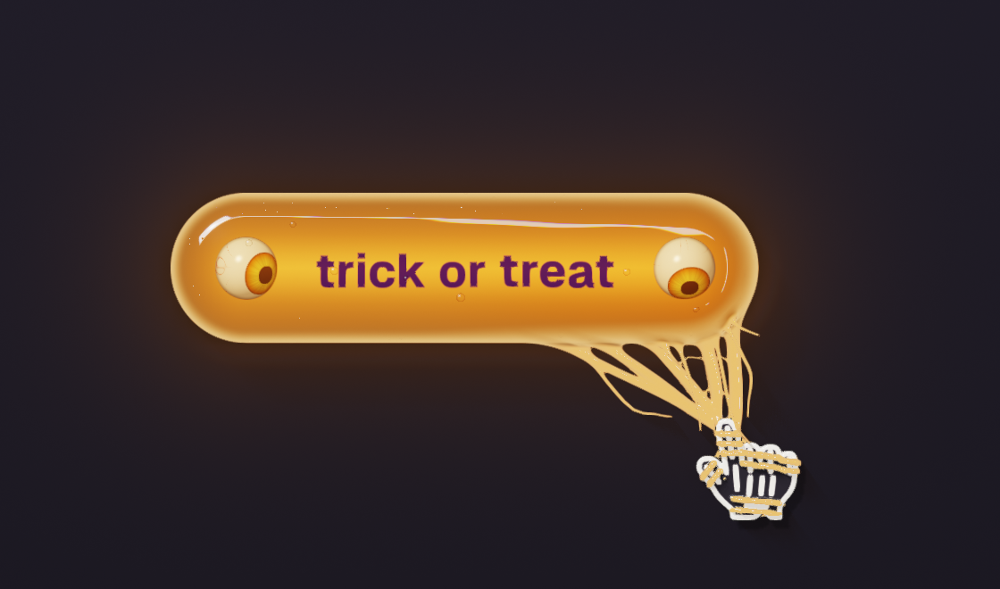
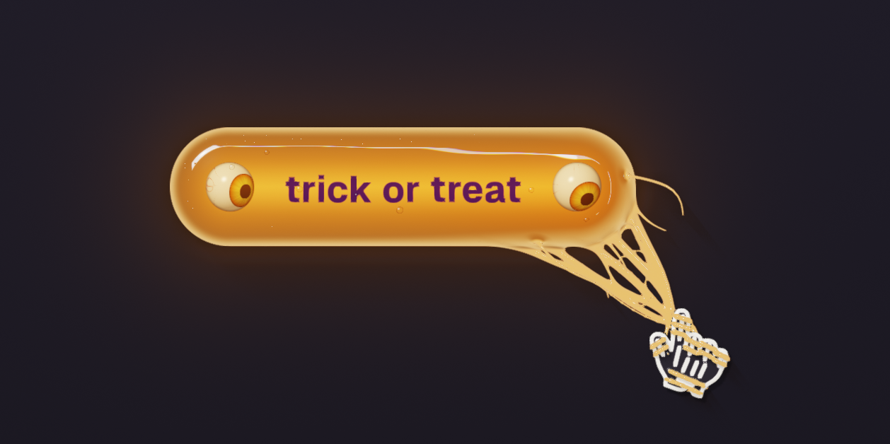
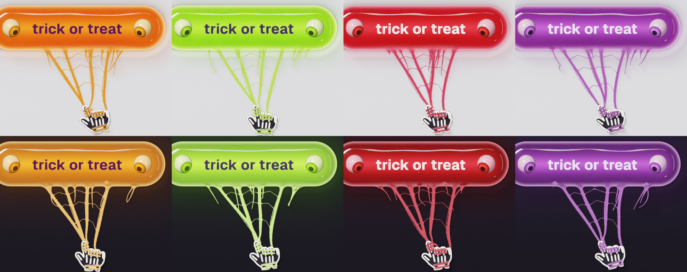
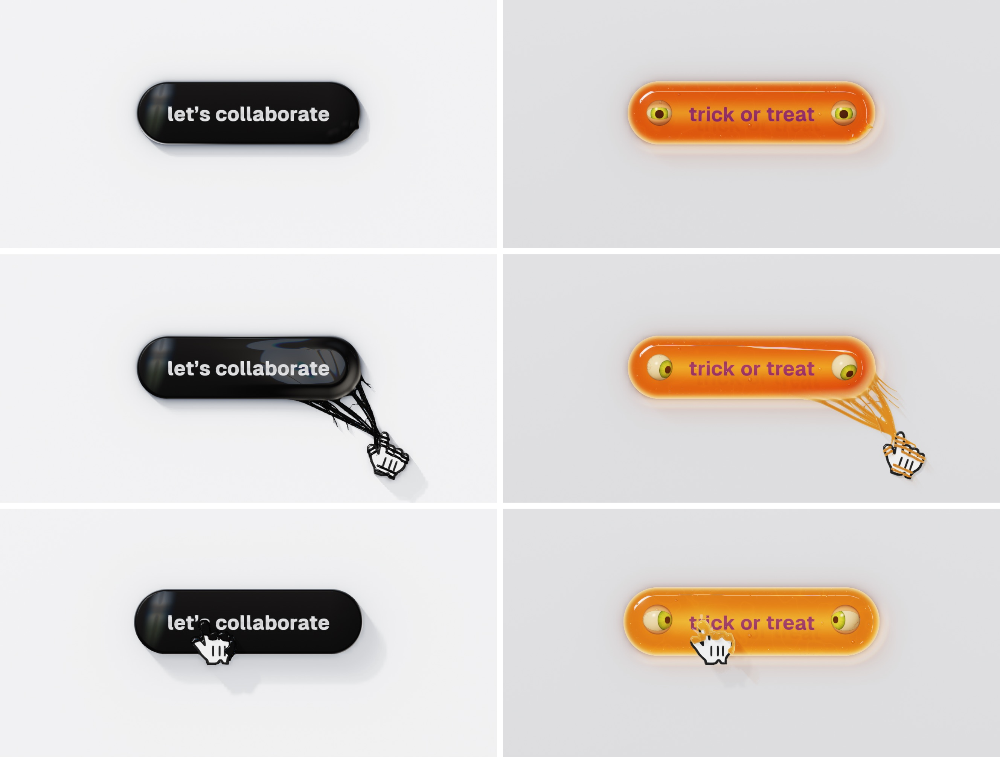

# Jelly Button

A Halloween button cast in gelatin. A plump pill of pumpkin jelly with **trick or treat** suspended inside it and a gummy eyeball floating in each end. The eyes doze until your pointer comes near, then open and follow it. Jelly strings reach out and wrap your skeleton-gloved hand. Press and it squashes, the eyes go wide, and it bounces back taller before it wobbles to a stop.

**[Live →](LIVE_URL)** · [Demo video (MP4)](media/demo.mp4)



One HTML file, raw WebGL2, no dependencies, no build step.

## Run it

Open `index.html` in a recent Chrome, Edge, Safari or Firefox, or serve the folder:

```bash
python3 tools/serve.py 3014 .
```

| | |
|:--|:--|
| Hover near it | the eyes open and follow you, the glow inside wakes, strings reach for the pointer |
| Hover over it | the skin swells toward your pointer and the highlight bends to follow you |
| Press | it dents under the finger and spreads; the eyes go wide with pinprick pupils |
| Release | it rebounds taller and narrower, rocks, and ripples ring out from where you let go |
| `1` – `4` or the chips | Pumpkin, Slime, Blood, Plum: the colours melt from one into the next |
| `D` or the Dark chip | light studio or Halloween night (follows your system until you choose) |
| `T` or the Tune chip | sliders for the jelly (wobble, glow, density…) and the strings (reach, snap, flow…) |
| `?flavor=slime&theme=dark` | open straight into a flavour and theme |

It is a real `<button>`: keyboard focusable, and it fires `jelly:activate`.

```js
JellyButton.element.addEventListener('jelly:activate', () => { /* … */ });
JellyButton.setFlavor('blood');
```



## What is ours, what is Venom's

This is a fork of exteestudio's [Venom Button](https://github.com/exteestudio/venom-button) (MIT). The top-down ray-marched scene, the string physics and the cursor icon that gets wrapped are theirs. Everything that makes it jelly and Halloween is new:

- **Gelatin.** You look through the jelly to the floor beneath, bent by refraction and coloured by depth: deep at the core, nearly clear at the thin edges, a milky haze only at the centre.
- **A candle inside.** The glow flickers, wakes as you come near and flares on a click; at night it lights the floor around it.
- **Letters suspended in the jelly**, softened and bent by the skin above them, with at least 4.7:1 contrast in every flavour and both themes (measured, `qa/contrast.py`).
- **Gummy eyeballs** with irises in each flavour's colour. They rest looking straight out, half asleep; only a pointer near the jelly is worth watching. They blink, sometimes twice, go wide when you press, and hang in the jelly so they swing a beat behind its wobble.
- **Jelly physics.** It plops down on load, squashes on an underdamped spring, rocks on two more, swells under a hover, dents under a press, and rings out ripples.
- **Wet skin.** Crisp studio highlights with faint rainbow fringes, an edge that glows in the jelly's own colour where light pipes through the rim, a few sweat beads and air bubbles.
- **Strings that carry the light.** At night they glow along their length in the flavour's colour.
- **Halloween cursor.** The arrow is a candy corn; the hand is a black skeleton glove. Same outlines as the originals, so the strings still wrap each finger.
- **A pointer that sits right.** Out in the open its shadow is drawn from its own outline, tight and soft; it rises only when it comes over the jelly.
- **Four flavours, two themes**, a tabbed Tune card in the flavour's colour, and a CSS jelly with both eyes for browsers without WebGL2. The original's no-WebGL fallback threw on load and never drew; that is fixed here.



## Compared with the original

Both rendered under identical conditions (same viewport and scale, same scripted pointer, `qa/compare.mjs`), scored 0–10:

| | Venom | Jelly |
|:--|:--:|:--:|
| Material & realism | **9** | 7.5 |
| Motion & physics | **9** | 8.5 |
| Character & idea | 8.5 | **9** |
| Reads as a button (label contrast 14.2:1 vs ≥4.7:1) | **9.5** | 8 |
| Polish & restraint | **9.5** | 7.5 |
| Performance (uncapped, 2880×1800: ~310 vs ~250 fps idle, ~305 vs ~130 busy) | **9.5** | 7.5 |
| Robustness & access | 6.5 | **8.5** |
| Customisation | 7.5 | **9.5** |
| **Overall** | **8.6** | **8.3** |

Venom is one idea, polished over 25 rounds; the jelly trades some of that restraint and speed for character, flavours, themes and a working fallback. The biggest gap left is that the straight-down camera hides the jelly's sides, where real jelly shows the most.



## QA

Headless Chrome over the DevTools protocol, real time and real mouse input (`qa/chrome.mjs`):

```bash
node qa/look.mjs                # idle, zoom, reach, hover, press, flavours, phone → qa/out/
node qa/eyes.mjs                # eyes rest when the pointer is far, track when near
node qa/cursor.mjs              # the pointer and its shadow: open floor, approaching, over the jelly, caught
node qa/ui.mjs                  # one cursor over the chips, the Tune card, hover swell and press dent
node qa/themes.mjs              # both themes, every flavour, and the theme switch
node qa/strings.mjs             # strings out, every flavour, both themes
node qa/legibility.mjs && python3 qa/contrast.py   # label contrast, every flavour, both themes, two sizes
node qa/small.mjs               # phone layout and reduced motion
CHROME_ARGS="--disable-3d-apis" node qa/nogl.mjs   # the CSS fallback
CHROME_ARGS="--disable-gpu-vsync --disable-frame-rate-limit" node qa/perf.mjs   # uncapped frame rate vs the original
CHROME_ARGS="--disable-gpu-vsync --disable-frame-rate-limit" node qa/demo.mjs   # re-record media/demo.mp4
```

## Credits

- **Original:** [Venom Button](https://github.com/exteestudio/venom-button) © 2026 exteestudio, MIT (see `LICENSE`). `qa/ref/venom.html` is an untouched copy, kept for the side-by-side tests.
- **Font:** [Geist](https://vercel.com/font) by Vercel and basement.studio, SIL Open Font License 1.1 (`fonts/Geist-OFL.txt`).
- **Cursor outlines:** `left_ptr` and `hand2` from the Figma Community file "Cursors" (`cursors/`), redrawn inside as a candy corn and a skeleton glove.
- **Techniques:** smooth-min and SDF primitives after [Inigo Quilez](https://iquilezles.org/articles/).
